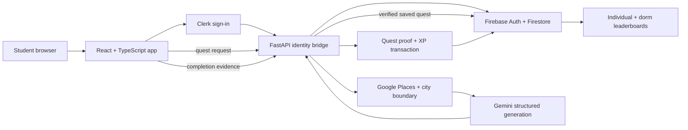

# Sidequester

### Turn “what should we do?” into a local adventure.

Sidequester is a student-focused activity app that turns a person's time, budget,
interests, and starting location into a practical, AI-generated sidequest around
Gainesville, Florida. Instead of scrolling through another directory of places,
students get a clear objective, ordered actions, a real destination, and a
finish line.

**The idea:** make it easier to get out, try something nearby, and make an
ordinary afternoon feel like a small adventure.

---

## What makes it different

- **A quest, not a list.** Gemini creates one connected activity with a playful
  title, a concrete objective, actionable steps, and a measurable completion
  criterion.
- **Grounded in real places.** The backend discovers destinations through
  Google Places and checks that they fall inside the Gainesville city boundary.
  Gemini does not get to invent trusted coordinates.
- **Personalized to the person and the moment.** Time, budget, interests, goals,
  vibe, and distance can shape the activity. A multi-stop option can build an
  ordered route from verified places.
- **Designed to be completed.** Location and photo proof can support XP-eligible
  steps; recreation-only quests are available for fun without verification or
  XP. Estimates are checked against selected time and budget bounds.
- **Progress with a community angle.** Students can save quests, track active
  sidequests, earn XP for eligible completion, and compare individual or dorm
  leaderboards.

## A student flow

1. Choose a place or starting point, or use the current location.
2. Set time, budget, and (optionally) distance limits.
3. Add preferences, goals, and optional advanced settings such as multi-stop
   routes and verification methods.
4. Generate a sidequest. Guests see an unsaved preview; signed-in students can
   save it to their account.
5. Follow the quest and complete its proof requirements to earn eligible XP.

> Quest duration and cost are estimates, not guarantees. A verified destination
> confirms the place and its location; GPS proximity does not prove that an
> activity was performed.

## Product highlights

| Experience | What students can do |
| --- | --- |
| Personalized sidequests | Generate a new quest from interests, vibe, goals, time, budget, and location |
| Verified destinations | Discover Gainesville places and check them against a city-limit boundary |
| Multi-stop quests | Request an ordered route of verified destinations with steps mapped to each stop |
| Quest progress | Keep up to three active personal quests, view details, and complete or abandon them |
| Proof and XP | Use location or reviewed photo proof for eligible steps; choose recreation-only quests with no XP |
| Leaderboards | Compare individual XP or aggregate XP by UF residence |
| Vibes and preferences | Save preferences and goals, then reuse a vibe to quickly shape a quest |
| Organization board | Browse published public organization quests and accept an individualized version |

The organization board requires published organization and quest records; the
project does not seed sample organizations. Dorm choices come from the backend
residence catalog, including “Off campus.”

## How it works



The browser application is built with React, TypeScript, Vite, and Tailwind CSS.
FastAPI validates request/response contracts, coordinates destination selection
and generation, and owns authenticated quest persistence and completion.
Firestore stores user and quest state. Clerk handles the sign-in experience;
the backend verifies the Clerk session and exchanges it for a Firebase session
used by authenticated API requests.

### XP integrity

Quest generation and saving do not award XP. Eligible completion is handled
server-side in a Firestore transaction: quest progress and the user's and dorm's
XP updates commit together, and a completed stop cannot be awarded twice.
Multi-stop quests award their eligible share as stops are completed.

### Destination integrity

Places are selected from Google Places results and checked against a bundled
Gainesville city boundary. The boundary is a reviewed data-processing snapshot,
not a legal survey; annexations may change it. See
[`backend/data/README.md`](./backend/data/README.md) for attribution and
processing notes.

## Technology

| Layer | Tools |
| --- | --- |
| Frontend | React 19, TypeScript, Vite, Tailwind CSS |
| Identity | Clerk session with a backend-verified Firebase Auth bridge |
| Data and persistence | Firebase Auth, Firestore, Firebase Admin SDK |
| API | Python, FastAPI, Pydantic |
| AI generation and photo review | Gemini REST API with structured JSON validation |
| Place discovery and maps | Google Places, Google Maps JavaScript APIs |
| Tests | Python `unittest`, frontend Node tests, Firestore emulator integration tests |

## Run locally

You need Node.js/npm, Python 3.11+, and configured development credentials for
the services you intend to use. The app uses external Clerk, Firebase, Gemini,
and Google Maps/Places services; without their configuration, corresponding
features will not work.

### 1. Configure the backend

From the repository root, copy `.env.example` to `.env`, then fill in the
backend settings:

- `CLERK_ISSUER` and `CLERK_SECRET_KEY` from the same Clerk instance used by the
  frontend publishable key.
- `GOOGLE_APPLICATION_CREDENTIALS` pointing to a Firebase Admin service-account
  JSON stored **outside the repository**.
- `GEMINI_API_KEY` for quest generation and photo review.
- `GOOGLE_PLACES_API_KEY` for server-side destination discovery, with Places API
  (New) enabled.
- `GAINESVILLE_BOUNDARY_PATH=backend/data/gainesville-boundary.geojson`.
- `FRONTEND_ORIGINS` containing the exact local browser origin(s), typically
  `http://localhost:5173,http://127.0.0.1:5173`.

Keep all secret values out of source control and never put backend credentials
in a `VITE_` variable. `.env.example` contains placeholders only.

Install dependencies and start the API from the repository root:

```powershell
python -m venv .venv
.\.venv\Scripts\Activate.ps1
python -m pip install -r requirements.txt
python -m uvicorn main:app --reload --env-file .env
```

The API health check is `http://127.0.0.1:8000/health`; interactive API docs
are at `http://127.0.0.1:8000/docs`.

### 2. Configure and start the frontend

In `Sidequester_Frontend/`, copy `.env.example` to `.env.local`. Set:

- `VITE_CLERK_PUBLISHABLE_KEY` for the same Clerk instance configured in the
  backend.
- `VITE_GOOGLE_MAPS_API_KEY` to a browser key restricted by HTTP referrer and
  enabled APIs. The frontend uses Maps JavaScript, Places, Geocoding, and
  Routes APIs.
- `VITE_API_BASE_URL=http://127.0.0.1:8000` for local backend access.

Then run:

```powershell
cd Sidequester_Frontend
npm install
npm run dev
```

Open the local URL printed by Vite. If Vite chooses another port, add that
origin to backend `FRONTEND_ORIGINS` and restart the API. Restart the relevant
development server after changing its environment file.

For more detail, see the [frontend setup guide](./Sidequester_Frontend/README.md),
[backend guide](./backend/README.md), and
[Clerk/Firebase setup notes](./backend/docs/AUTH_SETUP.md).

## Quality checks

From `Sidequester_Frontend/`:

```powershell
npm run build
npm run lint
node --experimental-vm-modules --test tests/*.test.mjs
```

From the repository root, after installing backend dependencies:

```powershell
python -m unittest discover -s backend/tests -v
```

Firestore emulator integration tests require a local emulator and
`FIRESTORE_EMULATOR_HOST`; without it, those tests are skipped. Test instructions
and emulator safety notes are in [`backend/README.md`](./backend/README.md).

## Repository map

```text
.
├── Sidequester_Frontend/
│   ├── src/features/       # Quest generation, quests, preferences, vibes, settings, boards
│   ├── src/services/       # API, Firebase session, maps, and preference services
│   └── tests/              # Frontend behavior and service tests
├── backend/
│   ├── api/                # FastAPI routes
│   ├── auth/               # Identity bridge and Firebase helpers
│   ├── quests/             # Contracts, generation, destinations, persistence, completion
│   ├── organizations/      # Public organization quest board
│   ├── users/              # Residence catalog and XP helpers
│   ├── data/               # Gainesville city-boundary data and attribution
│   ├── docs/               # API, setup, and integration guides
│   └── tests/              # Unit, route, and emulator tests
├── docs/                   # Deployment guide
└── main.py                 # FastAPI application entry point
```

## Deployment and current scope

The deployment guide describes Firebase Hosting for the frontend and a FastAPI
backend exposed through Tailscale Serve. **In that deployment, API-backed
features require a device connected to the configured tailnet**, even though
the frontend shell is publicly hosted. See [`docs/DEPLOYMENT.md`](./docs/DEPLOYMENT.md)
before presenting the hosted build as publicly usable end to end.

The organization board depends on configured Firestore content, and real
generation/completion flows depend on correctly configured provider credentials,
Firebase Auth, Firestore access, and security rules. The documentation describes
the implemented contracts and local test coverage; it is not a claim that every
external integration has been verified in every deployment.

## Security notes

- Do not commit `.env`, Firebase Admin service-account files, or provider
  credentials. Keep the Admin credential outside the repository.
- Browser API keys are visible in the frontend bundle; restrict them by referrer
  and API. Never put Gemini, Places server, Clerk secret, or Firebase Admin
  credentials in frontend variables.
- Production Firestore rules must keep XP, quest assignments, and completion
  state server-owned. Review [`backend/docs/AUTH_SETUP.md`](./backend/docs/AUTH_SETUP.md)
  and your deployed rules before launch.
- Public Gemini generation can incur provider cost. Apply appropriate quotas
  and edge rate limits before opening the API broadly.

## More documentation

- [Backend API and development](./backend/README.md)
- [Frontend development](./Sidequester_Frontend/README.md)
- [Authentication setup](./backend/docs/AUTH_SETUP.md)
- [Quest generation](./backend/docs/TASK4_GEMINI.md)
- [Saved quests, proof, and completion API](./backend/docs/TASK5_API.md)
- [Organization quest board](./backend/docs/ORGANIZATION_QUESTS.md)
- [Deployment](./docs/DEPLOYMENT.md)
- [Gainesville boundary attribution](./backend/data/README.md)
