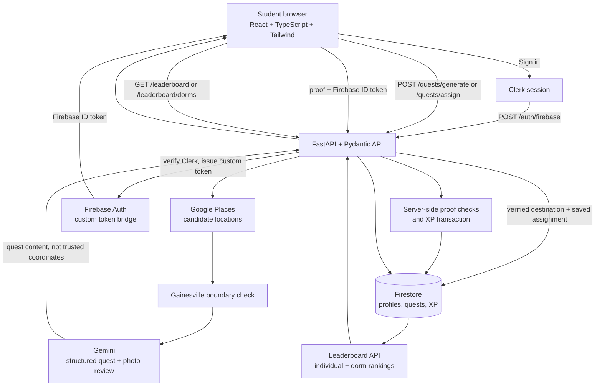

# Sidequester

### Turn “what should we do?” into a local adventure.

Sidequester is a student-focused activity app that turns a person's time, budget,
interests, and starting location into a practical, AI-generated sidequest around
Gainesville, Florida. Instead of scrolling through another directory of places,
students get a clear objective, ordered actions, a real destination, and a
finish line.

**Hackathon demo:** [studentsidequest.web.app](https://studentsidequest.web.app)
· [API docs](https://aguy-server.tail8f28f1.ts.net/docs) (available to
Tailscale-connected devices)

**The idea:** make it easier to get out, try something nearby, and make an
ordinary afternoon feel like a small adventure.

---

## What makes it different

- **A quest, not a list.** Gemini creates one connected activity with a playful
  title, a concrete objective, actionable steps, and a measurable completion
  criterion.
- **Grounded in real places.** The backend discovers destinations through
  Google Places and checks that they fall inside the Gainesville city boundary.
  Gemini does not get to invent trusted coordinates.
- **Personalized to the person and the moment.** Time, budget, interests, goals,
  vibe, and distance can shape the activity. A multi-stop option can build an
  ordered route from verified places.
- **Designed to be completed.** GPS presence checks and accepted photo
  evidence can support personal quest XP. Recreation-only quests are available
  for fun without verification or XP. Estimates are checked against selected
  time and budget bounds.
- **Progress with a community angle.** Students can save quests, track active
  sidequests, earn XP for eligible completion, and compare individual or dorm
  leaderboards.

## A student flow

1. Choose a place or starting point, or use the current location.
2. Set time, budget, and (optionally) distance limits.
3. Add preferences, goals, and optional advanced settings such as multi-stop
   routes and verification methods.
4. Generate a sidequest. Guests see an unsaved preview; signed-in students can
   save it to their account.
5. Follow the quest; location checks or accepted photo proof can earn personal quest XP.
   Global-event check-ins use their configured reward (25 XP by default), once per person.

> Quest duration and cost are estimates, not guarantees. A verified destination
> confirms the place and its location; GPS proximity does not prove that an
> activity was performed.

## Product highlights

| Experience | What students can do |
| --- | --- |
| Personalized sidequests | Generate a new quest from interests, vibe, goals, time, budget, and location |
| Verified destinations | Discover Gainesville places and check them against a city-limit boundary |
| Multi-stop quests | Request an ordered route of verified destinations with steps mapped to each stop |
| Quest progress | Keep up to three active personal quests, view details, and complete or abandon them |
| Proof and XP | Use GPS presence checks or reviewed photo proof for personal XP; choose recreation-only quests with no XP |
| Leaderboards | Compare individual XP or aggregate XP by UF residence |
| Vibes and preferences | Save preferences and goals, then reuse a vibe to quickly shape a quest |
| Organization board | Browse published public organization quests and accept an individualized version |

The organization board requires published organization and quest records; the
project does not seed sample organizations. Dorm choices come from the backend
residence catalog, including “Off campus.”

## Technical accomplishments

- Built an end-to-end React and FastAPI product, from preference-driven quest
  creation through destination resolution, saved progress, evidence review,
  completion, XP, and leaderboards.
- Grounded generated activities in real places: Google Places candidates are
  checked against a bundled Gainesville boundary before their coordinates can
  be used as trusted quest destinations.
- Added single- and multi-stop quest flows. Multi-stop quests use an ordered
  set of distinct verified places, map steps to stops, and award eligible XP
  as stops are completed.
- Kept progress rules server-owned. Firestore transactions protect quest
  assignment and XP updates, including duplicate completion attempts; guests
  can try unsaved previews without receiving XP.
- Implemented selectable proof methods. GPS proximity checks can earn configured XP;
  Gemini reviews ephemeral photos for XP-eligible
  personal steps. Recreation-only quests are available without proof or XP.
- Hardened Firestore access with a deny-by-default ruleset: users can access
  their own profile, active quest reads, and saved vibes, while XP and quest
  writes remain server-managed. The checked-in rules still need a reviewed
  deployment before they can be treated as the live project's policy.
- Kept Gemini's reviewer instructions separate from JSON-encoded, untrusted
  quest text and the submitted image; malformed review output fails closed.
  Global-event GPS/time check-ins preserve the configured one-time reward; browser
  GPS proves proximity rather than independent evidence of attendance.
- Made quest generation more resilient to estimate mistakes: the backend states
  normalized time and budget limits explicitly in the Gemini prompt and gives
  one bounded correction attempt with the exact failed estimate before returning
  an error. The server still enforces the requested limits after the retry.
- Connected Clerk sign-in to Firebase Auth with a backend-verified identity
  bridge, then use Firebase ID tokens for authenticated API calls.
- Built individual and residence leaderboards, organization-published quest
  acceptance, and a responsive, mobile-friendly quest board.
- Added unit, API-boundary, frontend service, and Firestore-emulator tests for
  important validation and persistence behavior.

## How it works



The browser application is built with React, TypeScript, Vite, and Tailwind CSS.
FastAPI validates request/response contracts, coordinates destination selection
and generation, and owns authenticated quest persistence and completion.
Firestore stores user and quest state. Clerk handles the sign-in experience;
the backend verifies the Clerk session and exchanges it for a Firebase session
used by authenticated API requests.

### Important API routes

Interactive OpenAPI documentation is available at `/docs` on the API host.
Unless noted, routes that read or change a student's saved data require an
`Authorization: Bearer <Firebase ID token>` header.

| Route | Access | What it does |
| --- | --- | --- |
| `POST /auth/firebase` | Clerk session | Verifies Clerk identity and returns a Firebase custom token for sign-in |
| `POST /quests/generate` | Public preview | Generates an unsaved quest preview; guest-friendly and awards no XP |
| `POST /quests/assign` | Firebase token | Generates and saves a verified quest assignment (up to three active) |
| `GET /me/active-quests` | Firebase token | Reloads the student's active quests |
| `POST /quests/{id}/steps/{step}/photo-proof` | Firebase token | Reviews an uploaded photo for an eligible step; image bytes are not retained |
| `POST /quests/{id}/complete` | Firebase token | Checks completion evidence and transactionally awards eligible XP |
| `GET /organization-quests` | Public | Lists published organization quests |
| `POST /organization-quests/{org}/{quest}/accept` | Firebase token | Generates and saves a personal assignment from a published quest |
| `GET /leaderboard`, `GET /leaderboard/dorms` | Firebase token | Returns individual or residence XP rankings |
| `GET /me/dorm`, `PUT /me/dorm` | Firebase token | Reads or updates residence selection from the server catalog |

The complete contracts, validation rules, and additional endpoints are available
in the API docs and the linked backend guides below.

### XP integrity

Quest generation and saving do not award XP. XP-eligible location/photo completion is handled server-side in a Firestore transaction:
quest progress and the user's and dorm's XP updates commit together, and a
completed stop cannot be awarded twice. GPS and photo completion retain configured rewards; recreation-only completion
awards no XP. Global-event GPS/time check-ins award the configured reward once per
person. Browser-reported GPS remains a limited signal, not proof of participation.

### Security notes

The backend receives identity from verified Firebase tokens, not request bodies,
and Firebase Admin performs XP updates. Browser Firestore access is scoped to a
student's own profile/preferences, saved vibes, and active-quest reads; other
collections and client-side quest writes are denied by the checked-in policy at
[`backend/security/firestore-global-quests.rules`](./backend/security/firestore-global-quests.rules).
Review and deploy that ruleset through the project's normal release process; the
repository copy alone does not confirm the currently deployed policy.

### Destination integrity

Places are selected from Google Places results and checked against a bundled
Gainesville city boundary. The boundary is a reviewed data-processing snapshot,
not a legal survey; annexations may change it. See
[`backend/data/README.md`](./backend/data/README.md) for attribution and
processing notes.

## Technology

| Layer | Tools |
| --- | --- |
| Frontend | [React 19](https://react.dev/), [TypeScript](https://www.typescriptlang.org/), [Vite](https://vite.dev/), [Tailwind CSS](https://tailwindcss.com/), [Framer Motion](https://www.framer.com/motion/) |
| Identity | [Clerk](https://clerk.com/) session with a backend-verified [Firebase Auth](https://firebase.google.com/docs/auth) bridge |
| Data and persistence | [Firebase Auth](https://firebase.google.com/docs/auth), [Cloud Firestore](https://firebase.google.com/docs/firestore), Firebase Admin SDK |
| API | [Python](https://www.python.org/), [FastAPI](https://fastapi.tiangolo.com/), [Pydantic](https://docs.pydantic.dev/) |
| AI generation and photo review | [Google Gemini API](https://ai.google.dev/gemini-api/docs) with structured JSON validation |
| Place discovery and maps | [Google Places API](https://developers.google.com/maps/documentation/places/web-service), [Google Maps JavaScript API](https://developers.google.com/maps/documentation/javascript) |
| Tests | Python `unittest`, frontend Node tests, Firestore emulator integration tests |

## AI disclosure and credits

Sidequester uses Google's Gemini API at runtime to draft personalized quests
and review submitted photo evidence. AI output is treated as untrusted: the
backend validates quest structure and estimates, selects destinations from
Google Places, checks them against the Gainesville boundary, and makes
completion and XP decisions. Sidequester is a purpose-built local-adventure
product—not a reskin of a general-purpose AI chat tool.

AI coding assistants, including GitHub Copilot, were also used to assist with
development. The project integrates and credits its frameworks, libraries, and
external APIs in the technology table above. Gainesville boundary data
attribution and processing details are documented in
[`backend/data/README.md`](./backend/data/README.md). Third-party names and
services remain the property of their respective owners; use of external APIs
is subject to their terms.

## Run locally

You need Node.js/npm, Python 3.11+, and configured development credentials for
the services you intend to use. The app uses external Clerk, Firebase, Gemini,
and Google Maps/Places services; without their configuration, corresponding
features will not work.

## Quality checks

From `Sidequester_Frontend/`:

```powershell
npm run build
npm run lint
node --experimental-vm-modules --test tests/*.test.mjs
```

From the repository root, after installing backend dependencies:

```powershell
python -m unittest discover -s backend/tests -v
```

Firestore emulator integration tests require a local emulator and
`FIRESTORE_EMULATOR_HOST`; without it, those tests are skipped. Test instructions
and emulator safety notes are in [`backend/README.md`](./backend/README.md).

## Repository map

```text
.
├── Sidequester_Frontend/
│   ├── src/features/       # Quest generation, quests, preferences, vibes, settings, boards
│   ├── src/services/       # API, Firebase session, maps, and preference services
│   └── tests/              # Frontend behavior and service tests
├── backend/
│   ├── api/                # FastAPI routes
│   ├── auth/               # Identity bridge and Firebase helpers
│   ├── quests/             # Contracts, generation, destinations, persistence, completion
│   ├── organizations/      # Public organization quest board
│   ├── users/              # Residence catalog and XP helpers
│   ├── data/               # Gainesville city-boundary data and attribution
│   ├── docs/               # API, setup, and integration guides
│   └── tests/              # Unit, route, and emulator tests
├── docs/                   # Deployment guide
└── main.py                 # FastAPI application entry point
```

## Deployment and current scope

The frontend is built to `Sidequester_Frontend/dist` and served publicly by
[Firebase Hosting](https://studentsidequest.web.app). The FastAPI backend runs
on an Ubuntu server and is exposed over HTTPS through Tailscale Serve at
`https://aguy-server.tail8f28f1.ts.net`. This keeps the API private to the
configured tailnet while allowing the static website to load publicly.

**API-backed features need Tailscale connectivity.** A phone or computer can
open the public site without joining the tailnet, but quest generation,
authentication, saved progress, and leaderboards need the backend, and the
backend is intended for tailnet-connected devices. The API address and server
availability depend on the current deployment. See
[`docs/DEPLOYMENT.md`](./docs/DEPLOYMENT.md) for the architecture and deployment
steps; do not represent the app as publicly usable end to end without this access.

The organization board depends on configured Firestore content, and real
generation/completion flows depend on correctly configured provider credentials,
Firebase Auth, Firestore access, and security rules. The documentation describes
the implemented contracts and local test coverage; it is not a claim that every
external integration has been verified in every deployment.

## More documentation

- [Backend API and development](./backend/README.md)
- [Frontend development](./Sidequester_Frontend/README.md)
- [Authentication setup](./backend/docs/AUTH_SETUP.md)
- [Quest generation](./backend/docs/TASK4_GEMINI.md)
- [Saved quests, proof, and completion API](./backend/docs/TASK5_API.md)
- [Organization quest board](./backend/docs/ORGANIZATION_QUESTS.md)
- [Deployment](./docs/DEPLOYMENT.md)
- [Gainesville boundary attribution](./backend/data/README.md)
